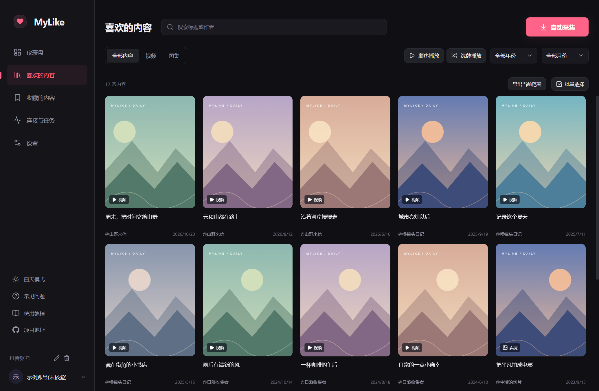
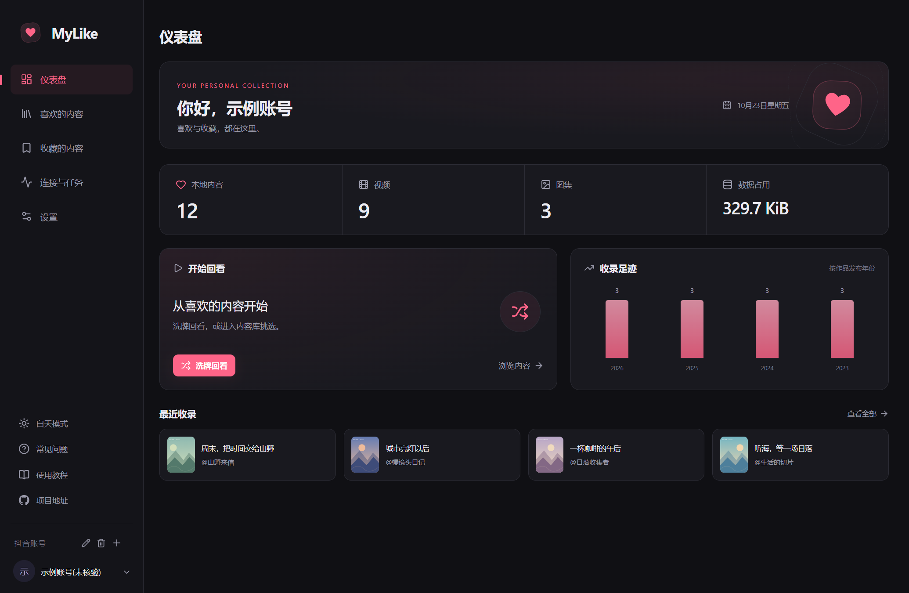

<div align="center">


# MyLike

**把喜欢留下来，让回看更简单。**

一个整理、搜索和回看抖音喜欢与收藏的 Windows 桌面应用。

[](https://github.com/Hannah2227/douyin-favorite-MyLike/releases/latest)
[](https://github.com/Hannah2227/douyin-favorite-MyLike/releases/latest)
[](https://github.com/Hannah2227/douyin-favorite-MyLike/actions/workflows/desktop.yml)
[](LICENSE)

[](https://github.com/Hannah2227/douyin-favorite-MyLike/stargazers)
[](https://github.com/Hannah2227/douyin-favorite-MyLike/forks)
[](https://github.com/Hannah2227/douyin-favorite-MyLike/releases)

[下载应用](https://github.com/Hannah2227/douyin-favorite-MyLike/releases/latest) · [功能特性](#功能特性) · [界面预览](#界面预览) · [反馈问题](https://github.com/Hannah2227/douyin-favorite-MyLike/issues)

</div>

## 界面预览

### 喜欢的内容



### 仪表盘



## 下载

**[下载最新版 · Windows x64](https://github.com/Hannah2227/douyin-favorite-MyLike/releases/latest)**

在发布页下载文件名以 `portable.exe` 结尾的应用，保存到固定文件夹后双击运行，免安装使用。

升级前请退出旧版，再使用新版 EXE；旧 WPF 版的数据与登录态不迁移，首次使用新版需重新登录和采集。

## 功能特性

- **喜欢与收藏**：增量采集、断点续采、收藏夹同步与按夹浏览。
- **随手找到**：标题 / 作者搜索，类型与年月筛选，触底自动加载，长列表流畅浏览。
- **沉浸回看**：顺序 / 洗牌、断点续播、视频 / 图集 / 实况、倍速、全屏、播放列表与自定义快捷键。
- **边采边看**：后台采集或取消点赞时继续播放，任务进度和异常集中管理。
- **本地管理**：多账号隔离、账号改名与删除、批量整理、喜欢元数据导入导出、备份与缓存清理。
- **按你的习惯**：深浅主题、界面缩放、窗口记忆、播放偏好与内容仪表盘。

## 快速上手

1. **添加账号并登录**：在应用打开的抖音窗口中完成扫码登录，身份核验成功后窗口自动收起。
2. **收录内容**：采集喜欢，或进入收藏页同步收藏与收藏夹。
3. **开始回看**：直接点播，或在筛选范围内顺序 / 洗牌播放。

遇到滑块验证时，应用会暂停任务并打开抖音窗口；验证通过且原接口恢复后窗口自动收起，再手动继续任务。限流时请稍后重试。更多操作见应用内的「使用教程」与「常见问题」。

本地数据保存在 `%APPDATA%\MyLikeElectron`。本地删除与远端取消点赞是不同操作，取消点赞前会要求确认。

## 开发

使用 Electron + TypeScript + React + SQLite。需要 Node.js 24.12+、pnpm 11.22。

```powershell
cd apps/desktop
pnpm install --frozen-lockfile
pnpm dev
```

`pnpm test` 运行单元测试，`pnpm test:e2e` 运行桌面集成测试，`pnpm package:win` 生成 Windows 发行包。旧版源码、测试和构建流程统一保存在 [`legacy/`](legacy/)。

## 免责声明

- 本项目用于个人学习与账号内容整理，与抖音 / 字节跳动无关联，未经其授权或背书。
- 请仅访问和整理本人账号或已获授权的数据，遵守适用法律法规、平台服务条款及内容权利人的合法权益。请勿用于未经授权的采集、侵权传播或其他滥用行为。
- 视频、图片、音乐等内容的权利归原权利人所有；本地收录不代表获得转载、传播或其他使用授权。
- 平台接口、访问限制或内容状态变化可能导致功能不可用、采集不完整。请自行备份重要数据，并在批量取消点赞等操作前确认账号和范围。
- 软件按现状提供，不保证持续可用或适用于特定用途。在适用法律允许的范围内，作者不承担因使用本软件产生的账号限制、数据丢失等损失责任；具体以 [MIT License](LICENSE) 的担保与责任条款为准。

## 许可证

本项目采用 [MIT License](LICENSE)，第三方组件保留各自的版权和许可证，相关声明随发行包提供。
