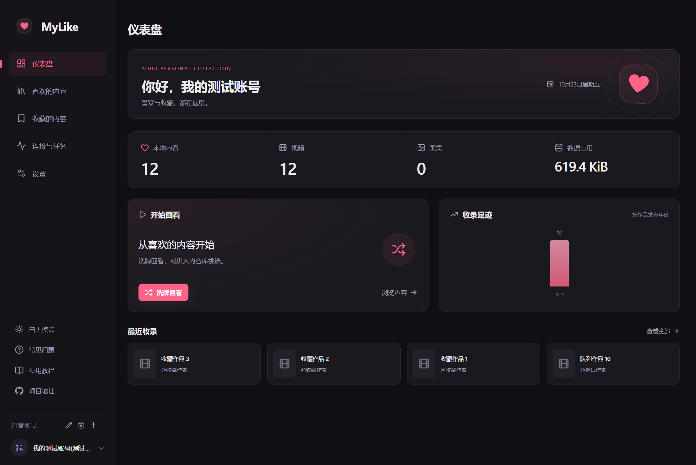

# MyLike

把自己的抖音喜欢与收藏整理到本机，搜索、筛选，再慢慢回看。

当前发布 **Electron 0.8.3 Windows 预览版**。应用采用 Electron + TypeScript + React + SQLite，登录与采集请求由真实抖音页面的 SDK 处理。本期仅支持 Windows x64，当前生产包在 Windows 11 验证。



## 下载与使用

到 [Electron 0.8.3 发布页](https://github.com/Hannah2227/douyin-favorite-MyLike/releases/tag/electron-v0.8.3) 下载：

- **`MyLike-0.8.3-win-x64-portable.exe`**：双击即可运行，无需安装 Node.js、.NET 或 WebView2；启动时会先解压运行文件。
- **`MyLike-0.8.3-win-x64.zip`**：完整解压到固定目录后运行 `MyLike.exe`。
- **`SHA256SUMS.txt`**：用于核对下载文件的 SHA-256。

首次使用：添加账号 → 在抖音窗口登录 → 自动采集喜欢或同步收藏 → 浏览、搜索和播放。遇到登录或验证问题，在账号窗口处理后手动继续；关闭应用后不会自动恢复后台任务。应用内提供常见问题和使用教程。

应用尚未签名，Windows 可能显示 SmartScreen 提示。请从本项目发布页下载，并核对文件来源和校验值。

## 主要功能

- **喜欢与收藏**：增量采集、断点续采、收藏夹同步及按夹浏览；喜欢、收藏和收藏夹支持触底加载。
- **内容库与仪表盘**：按标题 / 作者搜索，按类型、年月筛选；统计内容数量、发布年份和本机元数据占用。
- **播放**：顺序 / 洗牌、继续上次观看、视频与图集、实况静态照片停留、倍速、全屏、常驻播放列表及可设置的快捷键。
- **多账号**：独立列表与登录态、自定义名称；删除账号会清理本地数据、登录态、缓存及应用历史备份中的该账号记录。
- **任务管理**：采集可暂停或停止，取消点赞可停止，后台运行时仍可播放；喜欢采集、收藏同步和取消点赞三个后台任务互斥。
- **整理与设置**：批量本地删除、喜欢元数据 JSON 导入导出、数据库备份、缓存清理、深浅主题、窗口记忆和界面缩放。
- **取消点赞**：确认后逐条执行，保存每条结果；远端结果未知时不自动重发，可只读核验。打开原页看评论使用系统默认浏览器，其登录态与应用独立。

## 预览版范围

本机元数据可离线浏览，媒体仍需联网，不提供完整媒体下载。收藏与收藏夹已完成受控测试，**真实账号只读验收仍待完成**；干净 Windows 机器、真实人工验证恢复及数小时混合运行仍需进一步验证，macOS / Linux 暂不支持。[完整验收记录](docs/evidence/M6.md) 区分实际生产包、受控平台与真实账号结果。

这是独立的 Electron 重构版本，**不读取或迁移旧 WPF 版的数据、`.dylist` 或登录态**。旧版源码保留在 `src/DouyinShuffle.Win`，[旧版说明与下载](https://github.com/Hannah2227/douyin-favorite-MyLike/releases/tag/v1.0.7) 仍可查看；Electron 预览版使用独立版本号和 `electron-v*` 标签。

## 数据与隐私

应用数据默认保存在 `%APPDATA%\MyLikeElectron`，包含 SQLite 元数据、任务、播放记录、设置及独立浏览器会话；不访问旧版 `%LOCALAPPDATA%\DouyinShuffle`。不设置云端账号或遥测服务，平台请求直接访问抖音，媒体地址仅作短期缓存。

喜欢库导出不包含 Cookie、登录态、媒体链接和采集断点；收藏首期不提供导入导出。退出登录保留本地内容，删除账号则清理该账号及应用内历史备份中的相关记录。手动复制到应用之外的导出和备份由用户管理。[文件格式与恢复说明](docs/data-format.md)

## 开发

需要 Node.js 24.12+ 和 pnpm 11.22，在 `apps/desktop` 目录运行：

```powershell
pnpm install --frozen-lockfile
pnpm dev
```

构建、测试与代码边界见 [Electron 工程说明](apps/desktop/README.md)，需求和关键决策统一维护在 [PRD](docs/PRD.md)。自动化验证使用隔离数据和受控页面，不操作真实账号。

## 使用约定

本项目与抖音 / 字节跳动无关联，仅供个人学习和本地内容整理。请只处理自己的账号数据并遵守平台条款；平台接口变化可能需要后续适配。

## License

[MIT](LICENSE)
