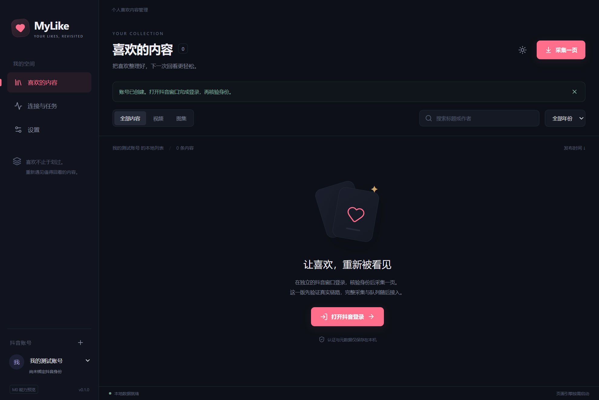
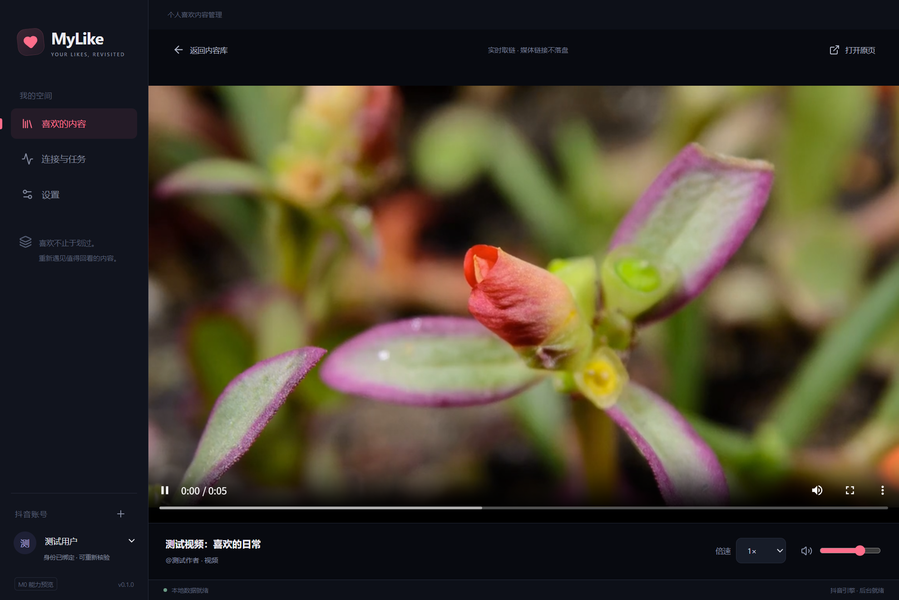

# M0 验证记录

2026-10-22 · MyLike 0.1.1 · **真实基础链路通过，M0 异常与稳定性验收尚未完成**。范围依据 [PRD](../PRD.md)，运行命令见 [Electron 工程](../../apps/desktop/README.md)。

## 环境与产物

- Windows x64，系统 build 26200；Ryzen 9 7940H，系统可见内存约 15 GiB。
- 生产运行时：Electron 44.0.0、Chromium 152.0.7977.54、Node 24.18.1、SQLite 3.53.1。
- `apps/desktop/dist/MyLike-0.1.1-win-x64-portable.exe`：101,736,688 字节，约 97 MiB。
- `apps/desktop/dist/MyLike-0.1.1-win-x64.zip`：157,142,710 字节，约 150 MiB；解压后运行 `MyLike.exe`。
- 产物为本地预览包，尚未发布 Release；默认用户数据在 `%APPDATA%/MyLikeElectron`。

## 已验证

| 检查 | 结果 |
| --- | --- |
| 类型、格式、构建、差异空白检查 | 通过 |
| 单元测试 | 11 项通过：64 位 ID / 游标精度、响应与 URL 解析、图集顺序、超时、事务回滚、账号隔离、数据库损坏保护 |
| 目录生产包集成测试 | 7 项通过：账号 / 主题重启保存、隐藏页面请求与分页、首页更新保留深层断点、IPC 拒绝越权、请求及初始化取消、媒体释放、引擎重建与 Cookie 跨重启保存 |
| 媒体样本 | MDN CC0 H.264 / AAC MP4 实际解码；实况切静态图时音乐保留，退出后视频与音频停止并移除资源 |
| 单 EXE 启动测试 | 通过：实际自解压启动、本地 UI、SQLite、账号 / 主题保存、退出与再次启动；通过本机 CDP 连接测试，未改应用权限 |
| ZIP / EXE 归档完整性 | 7zip 检查通过 |
| 真实匿名抖音页面 | 观察到页面 SDK 自动补签名；未登录请求返回 `API_REJECTED`，未绑定身份 |

集成测试使用独立临时目录和受控平台页面；测试素材不随包发行。单 EXE 启动测试见 `tests/portable-smoke.mjs`，真实匿名探测见 `tests/platform-smoke.mjs`。Windows CI 工作流已加入，远端 CI 尚未运行。

## 真实账号验收

用户亲自在生产目录包的抖音窗口登录，随后执行只读验收；数据和会话保存在新版自己的目录，未迁移旧版数据。

| 场景 | 结果 |
| --- | --- |
| 账号身份 | `profile/self` 返回真实身份并绑定；重启后无需重新扫码，身份再次核验通过 |
| 隐藏引擎分页 | 连续两页分别返回并新增 20 条，本地合计 40 条；重启后仍为 40 条 |
| 视频 | 实际解码播放 1080×1920 视频，媒体错误为空 |
| 静态图集与音乐 | 图片 1476×2446 加载成功，29 秒音乐实际播放；修复 `douyinstatic.com` CDN 被过滤的问题并加入域名边界回归 |
| 实况图集与音乐 | 实际解码 1280×720 动态子链，同时音乐就绪；退出后媒体元素全部释放 |
| 作品原页 | 新窗口共享操作账号的 Session，打开时本地播放器已暂停；关闭后自动续播仍待 M3 实现 |

这次仅采集两页；未执行全量采集、取消点赞或发送评论。真实样本和账号信息不写入代码、测试素材或截图。

## 内存观察

以下为 0.1.0 初版生产目录包、Playwright 调试连接、隐藏窗口、空库、匿名会话的一次采样；**不能当作普通用户场景的稳定指标**。

| 场景 | 进程工作集之和（MiB） | privateBytes 之和（MiB） |
| --- | --- | --- |
| 本地界面启动约 2 秒 | 377 | 249 |
| 真实抖音引擎加载、探测后 | 1,396 | 1,355 |
| 关闭引擎窗口后 10 秒 | 1,244 | 1,114 |
| 关闭引擎窗口后 30 秒 | 941 | 802 |

工作集求和会重复计入共享页；Windows 的 privateBytes 是私有提交量，不等于独占物理内存。其他采样也曾超过 1.5 GiB；此前估算偏乐观。

调试场景中，窗口销毁后仍有平台 Service Worker 运行。新增无调试连接的编译构建对照后，远端渲染进程可以退出，没有复现相同 Worker 残留；因此不能据前一组数据认定生产环境存在同样的泄漏。GPU 暖缓存和媒体服务仍有开销，暂不承诺释放后立即回到冷启动内存。

0.1.1 改用账号页作为引擎入口，仅关闭引擎的 WebGL；本地 UI / 播放器保留硬件加速。没有采用未带来明显收益的字体或媒体请求拦截，也没有通过清理 Cookie / 站点存储来降低内存。无调试对照可运行 `pnpm build` 后的 `node tests/platform-benchmark.mjs`；它使用编译产物而非发行 EXE，需与生产包调试采样分开解释。

本轮无调试连接、空库匿名会话的采样如下；引擎取数后等待 10 秒再测量。[原始记录](m0-memory-0.1.1.jsonl) 仅含脱敏指标。两组构建和采样条件不同，不据此计算固定优化比例。

| 场景 | 工作集之和（MiB） | privateBytes 之和（MiB） |
| --- | --- | --- |
| 本地界面启动约 2 秒 | 364 | 239 |
| 账号页引擎加载并静置 | 1,269 | 1,170 |
| 释放引擎后 10 秒 | 683 | 591 |
| 释放引擎后 30 秒 | 676 | 583 |

释放后仅剩本地 UI 的渲染进程，运行的 Service Worker 为 0；内存仍高于冷启动。因此后续长任务应在已提交页之间按预算回收引擎，不能宣称当前内存问题已全部解决。

## M0 剩余验收

1. 人工验证、网络中断、页面自动重载的恢复；当前首次匿名探测可能因导航返回 `CANCELLED`，再次探测可继续，不能当作用户主动停止后自动重试的依据。
2. 更广泛的媒体与机器兼容性、版权 / 失效资源处理；本轮真实样本不代表所有作品均可播放。
3. 长时间采集和登录 / 播放 / 验证的完整生产内存基线；其他桌面平台尚未测试。

全量自动采集、完整增量任务、批量管理、播放队列 / 洗牌 / 续播、导入导出、取消点赞仍属于后续 M1—M4，不能视为已完成。

## 界面

截图来自生产包与受控测试账号，视频使用 MDN 示例素材。

