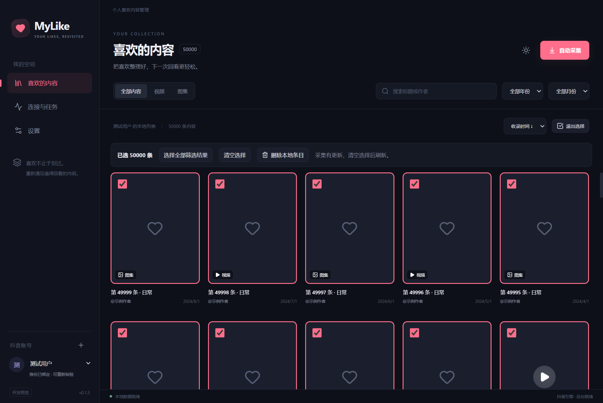
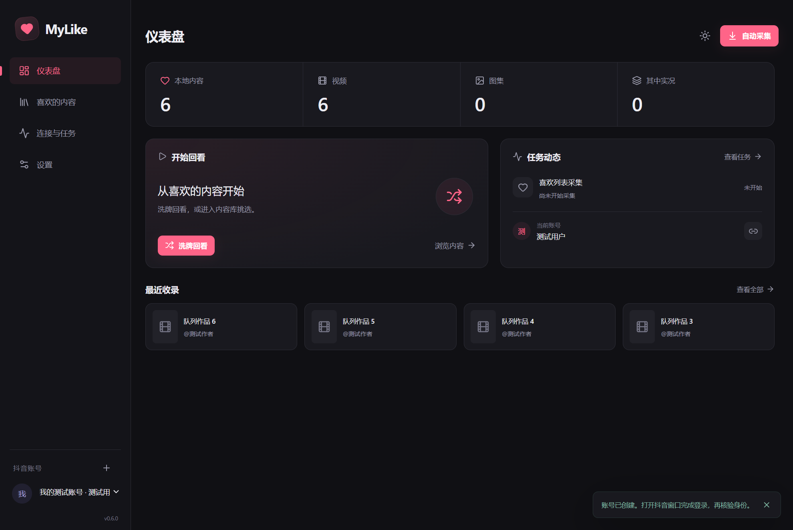
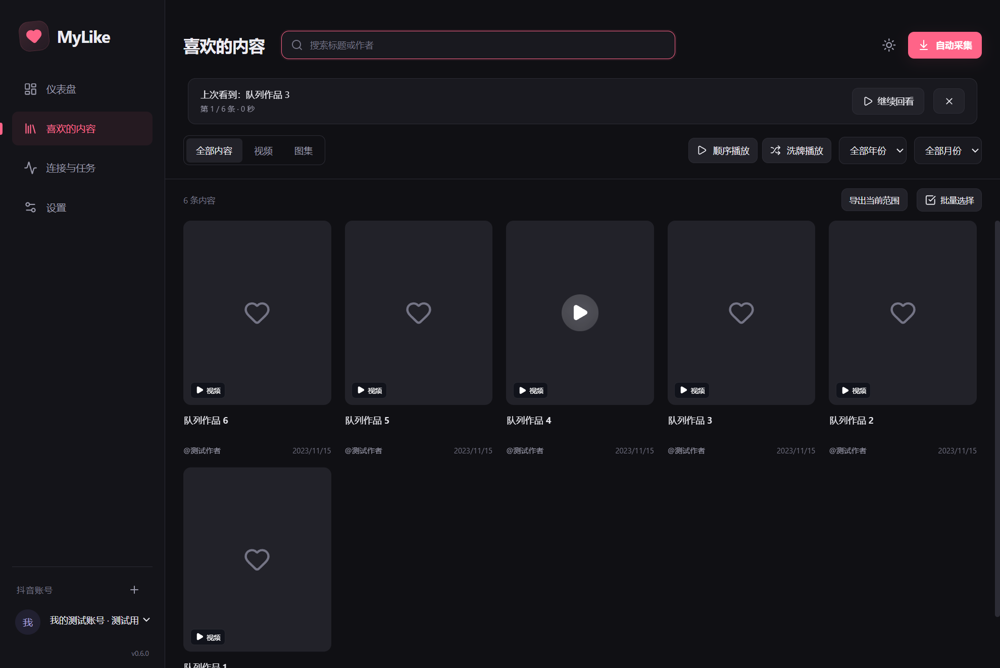
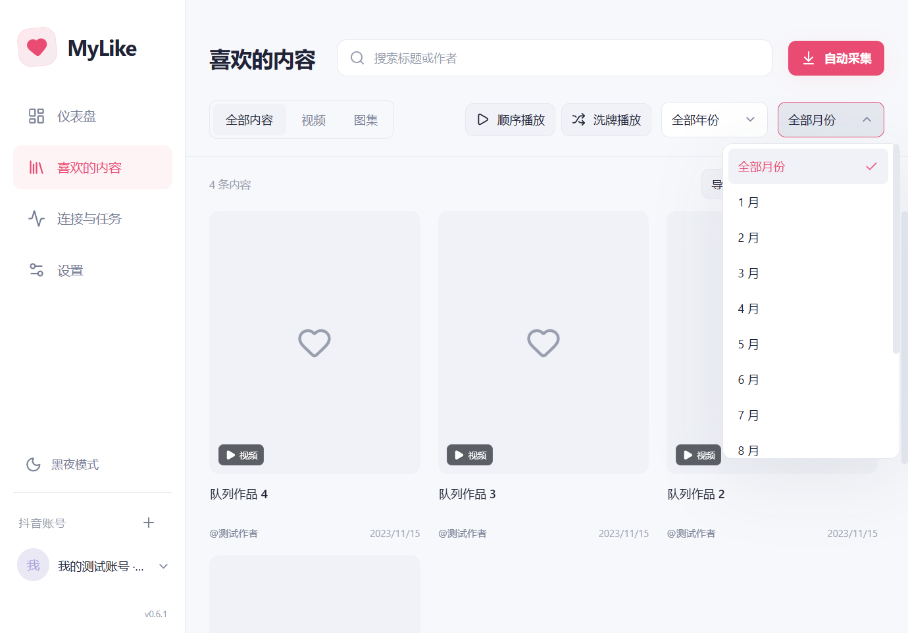
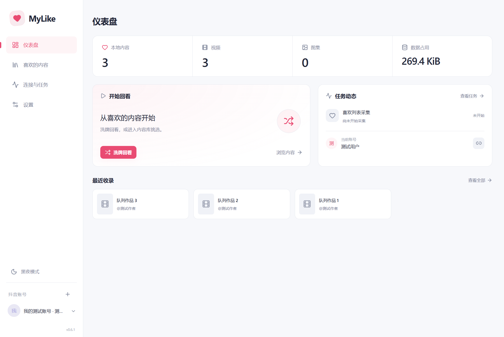

# 内容库阶段记录

2026-10-22 · MyLike 0.1.3 · 内容库核心的开发构建与 Windows 生产包验证通过。

- 年份 / 月份、标题 / 作者、视频 / 图集筛选；发布时间或收录时间倒序。
- 虚拟化网格、分页查询和跨视图滚动保留。
- 单条选择、清空、选择全部筛选结果，保存确定的 ID 集合；当前单次上限 10 万条，超出明确报错。
- 有选择时保留显示中的列表，采集更新单独提示；新条目不会加入已有选择。
- 本地删除有确认；批量操作先备份，事务失败整批回滚，共享作品在其他账号中保留。
- 读取失败与空列表分别显示，可重试；无筛选结果提供清空筛选。
- 页面导航中断使用独立错误类型并有限重试；主动暂停或停止不自动重试。

25 项单元测试、11 项开发构建与 11 项目录生产包桌面测试通过；单 EXE 自解压启动和重启测试通过。5 万条临时数据的生产包首次 worker + IPC 查询为 391ms，20 次常用查询 p95 为 201ms（开发构建分别为 388ms / 202ms）；该组数据和本机负载下达到 PRD 目标，不能推断所有机器均可达到。实际网格卡片数量低于 100。

单 EXE 为 101,742,341 字节，ZIP 为 157,150,986 字节；仅为本地预览产物，尚未发布 Release。

0.1.3 真实会话升级保留 218 条数据；无需人工配合继续两页后为 258 条，随后主动暂停。导航中断有限重试通过，不涉及远端写操作。

桌面测试选择 5 万条后再采入一条：选择仍为 5 万条，确认删除后新条目保留，另一账号共享的作品也保留。测试只使用临时目录和受控素材，没有删除真实账号内容。

账号重命名 / 移除、完整设置和数据交换仍待后续实现；内容库核心通过不代表所有里程碑均已验收。

## 0.6.0 主界面与仪表盘

侧栏新增独立仪表盘，默认启动仍进入内容库。统一中性深色、控件间距和文字层级，内容卡片标题最多两行；顶部搜索、筛选、顺序 / 洗牌播放位置保留。

概览由数据库 worker 汇总当前账号总数、视频、图集与其中实况，最近收录最多返回四条；展示最近任务、继续播放和完整账号范围的回看入口。加载和失败不显示假零，旧账号迟到结果不写入新概览。已有搜索与选择不会改变仪表盘播放范围，返回后保留原页面与筛选。

新增单元测试覆盖空账号、类型统计、删除后的更新、共享作品隔离和最近条目上限；桌面测试覆盖搜索下查看完整统计、洗牌范围、返回与切账号清空。本机该组 5 万条生产包查询首次 373ms、p95 180ms，仍在 PRD 目标内。完整生产回归与发行结果见 [M4](M4.md)。

[浅色主题与小窗口截图](m1-dashboard-light-0.6.0.png)。

## 0.6.1 主题、下拉框与占用

浅色窗口按钮区域随已保存主题初始化和切换；播放时独立使用深色，返回恢复。主题入口移至左栏账号上方，顶栏自动采集只在内容库显示。账号、年月、主题、快捷键和历史任务统一为主题化下拉菜单，支持方向键、首尾跳转、输入匹配、选中标记、禁用项、Esc 取消和点击外部关闭，长列表滚动并按可用空间向上展开。

仪表盘第四项改为数据占用，与设置共同读取本机 `mylike.sqlite`、WAL、共享内存文件的实际大小；覆盖全部账号，不含缓存、会话和备份，悬停显示统计范围。数据目录无法读取时报错，不能显示零值。新增单元检查覆盖占用范围与错误，桌面检查覆盖原生窗口配色调用、重启、页面专属入口、占用口径、键盘选择和 150% 缩放边界。完整生产验收见 [M4](M4.md)。

