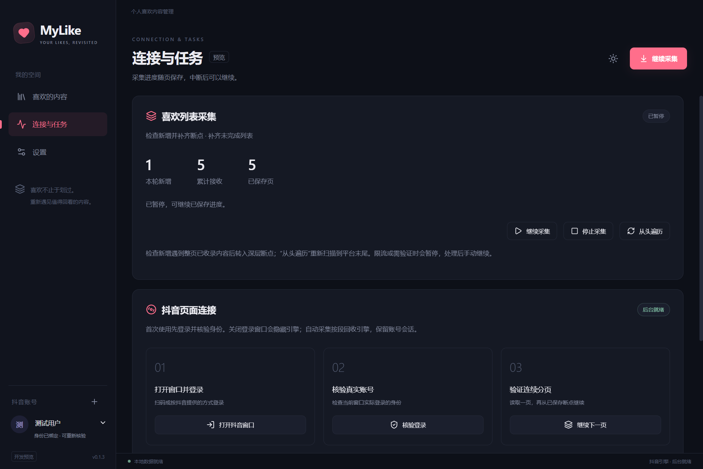

# 自动采集阶段记录

2026-10-22 · MyLike 0.1.2 · 有界真实采集与生产包通过，完整长列表和长时间稳定性尚未验收。

## 已实现与验证

- 独立采集服务和有界请求通道；播放取链优先于下一采集页。
- 检查新增、保留深层断点、从头遍历；未完成的新增扫描会继续原任务。
- 暂停、继续、停止，持久保存进度与错误；重启不自动发请求。
- 数据、分页游标、任务统计同一事务提交；异常空页、停滞和循环游标不推进断点。
- 网络和超时有限重试；登录或限流问题暂停；需登录时显示账号窗口，处理后手动继续。
- 每 8 页或 3 分钟在已提交页之间回收隐藏引擎，休息 4 秒后自动继续；保留登录会话。本地播放器不随之销毁。
- 升级现有 Electron v1 数据库前创建包含 WAL 提交内容的一致性备份；已有数据不清空。

21 项单元测试通过；9 项目录生产包集成测试通过，覆盖采集期间实际解码播放、暂停与重启继续、登录窗口、限流原因跨重启保留及旧版 M0 场景。单 EXE 实际自解压启动与重启测试通过。受控测试使用临时数据库和本地媒体素材，不涉及真实账号。

产物：`MyLike-0.1.2-win-x64-portable.exe` 101,740,604 字节；ZIP 157,147,304 字节。尚未发布 Release。

两种归档的 7zip 完整性检查通过；自解压 EXE 的尾部提示来自启动器附加数据，实际启动与重启测试已通过。

## 真实只读验收

使用用户已登录的生产会话；用户已授权离开期间继续开发及验证。未取消点赞、发送评论或改变远端数据。

| 检查 | 结果 |
| --- | --- |
| 升级前已有内容 | 40 条保留，账号仍绑定 |
| 自动采集 | 提交 10 页，新增 178 条，本地共 218 条，随后由验收脚本主动暂停 |
| 页间回收 | 观察到引擎窗口由一代更换为下一代，回收后任务继续提交；无需重新登录 |
| 重启 | 任务 ID、游标、10 页进度与 218 条数据一致；状态仍为暂停，引擎未启动 |

首次初始化遇到平台页面导航，0.1.2 返回 `CANCELLED` 并暂停，未推进断点；页面稳定后由脚本继续。后续将导航中断与主动停止区分，并仅对前者有限重试。不能把本次 10 页实测描述为完整喜欢列表采集完成，也不能据此宣称内存问题已解决。

## 尚待验收

真实人工验证恢复、全列表耗时与完整性、数小时连续运行、不同机器的媒体兼容性和生产进程组内存基线。M0 与其他里程碑进展见 [PRD](../PRD.md) 和 [M0 记录](M0.md)。

