# 播放阶段记录

2026-10-22 · MyLike 0.2.0 · Windows 生产包核心场景及真实列表只读重扫通过。

- 按筛选结果或选择集合创建固定队列，顺序 / 洗牌播放，点播、前后切换和侧栏跳转；5 万条队列内容和 DOM 有界性已用临时数据验证。
- SQLite 保存队列与视频 / 图集 / 音乐位置。进度绑定账号、队列和版本，乱序更新不能倒退位置；自然结束后不再提示续播。
- 快速切换取消旧取链；离开播放器取消未完成请求。媒体缓存最多两条、有效期两分钟，链接不写入 SQLite。
- 图集按设置轮播，换张保留音乐，最后一张等待音乐结束；暂停与续播保留图片和音乐位置。
- 音量、倍速、连播、轮播间隔与可自定义快捷键持久保存。全屏允许本地 UI 发起，Esc 先退出全屏。
- 原页共享账号 Session，打开时暂停；关闭仅恢复仍匹配的账号 / 队列 / 版本。切换账号关闭原账号窗口。
- 关闭应用前请求界面保存当前位置，响应有时间上限；异常退出仍可使用此前定期提交的位置。

32 项单元测试和 15 项生产包端到端测试通过，覆盖重启后实际跳转到保存的视频位置、应用关闭时保存最新位置、快速切换、原页提前关闭及过期回调、图集续播和音乐连续、未完成取链取消、5 万条队列与 HTML 全屏。单 EXE 自解压启动和重启通过，EXE / ZIP 完整性通过。

单 EXE 为 101,767,039 字节，ZIP 为 157,200,165 字节；尚未发布 Release。5 万条数据在该生产包中的首次查询为 372ms，20 次查询 p95 为 196ms，仅代表本机这组样本。

测试媒体支持 HTTP Range 并实际解码、跳转和触发自然结束。全部桌面测试使用独立临时目录和受控页面；尚未把这些结果当作真实平台所有媒体均兼容的证明。

真实会话已验证 1080×1920 视频实际解码、跳转到 2 秒并保存；重启保留同一队列，重新取链后从约 2.34 秒播放。原页共享 Session，打开时暂停，关闭后恢复实际播放。没有执行取消点赞或发送评论；真实作品和账号信息未写入测试文件或截图。

随后从既有断点继续到平台返回末尾：本轮任务累计 20 页、本地 397 条，无异常；已有视频队列仍为创建时的 146 条。再次从头扫描完成 21 页、接收 397 条、新增 0 条，队列仍为 146 条，期间共使用 3 代引擎，自动分段回收与去重通过。这不代表平台未返回的私密或失效作品也已收录。

全屏权限边界依据 [Electron Session 文档](https://www.electronjs.org/docs/latest/api/session#sessetpermissionrequesthandlerhandler)。真实平台的队列长时间运行、人工验证恢复和完整内存基线仍待验收。

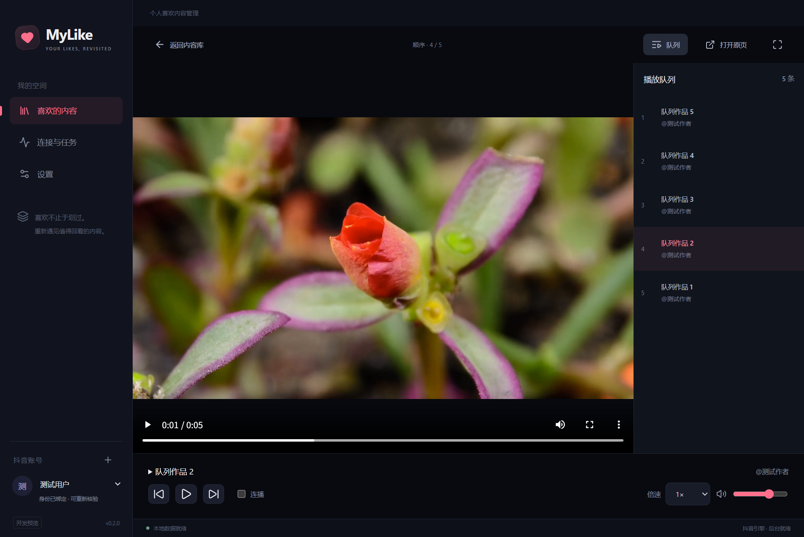

## 0.3.1 播放布局调整

根据用户反馈，进入播放时左栏动画收起，返回内容库恢复；可手动展开，视频元素不重建。媒体区全宽并保持比例，主要操作与进度集中到底部，移除原生视频控制条的重复界面；队列浮出并提供独立关闭入口。视频区域支持滚轮换作品，跨作品保留 700ms 手势间隔，避免一次滚动跳过多条。

开发构建对既有横屏素材验证了 1280×880 和 920×640 窗口，媒体区高度占播放器 80% 以上，无横向溢出，底部操作可见；拖动进度、收展左栏保持同一视频、返回恢复左栏、续播、图集音乐与全屏原页回归通过。后台批量取消点赞时进入播放器并切换作品的受控测试通过：当前写请求未被切歌取消，成功 2 条、未知 0 条，固定队列保留 6 条。采集与取消点赞保持互斥，媒体取链优先于下一项后台操作。

0.3.1 的完整 23 项 Windows 生产包桌面测试通过，包含上述布局及后台取消点赞组合、采集时播放、续播、原页恢复和全屏；51 项单元测试和格式 / 类型检查通过。单 EXE 的自解压启动、退出与重启通过，EXE / ZIP 完整性通过。单 EXE 101,780,845 字节、ZIP 157,215,202 字节；本机该生产包 5 万条查询首次 224ms、p95 112ms。没有执行真实远端写操作；用户反馈的真实取消点赞验收另记于 M4。

以下为生产包受控测试素材截图，窗口分别为 920×640 和默认尺寸，图片分辨率随系统缩放。

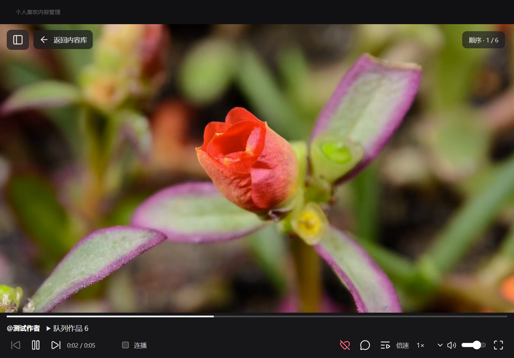

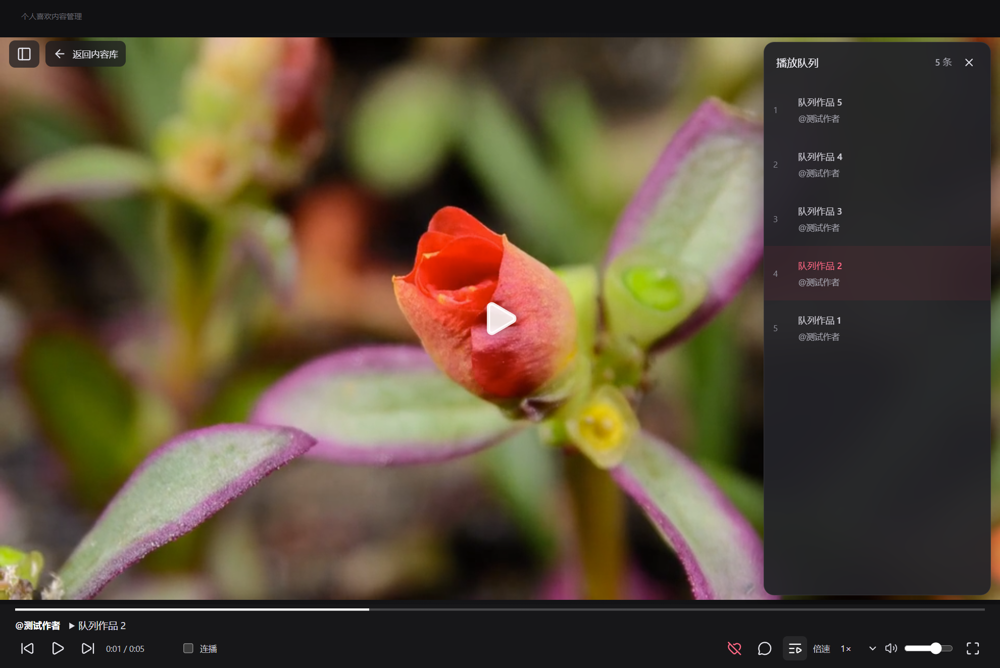

## 0.3.2 竖屏尺寸修复

用户随后反馈视频大小、比例和位置不对。新增真正可解码的 1080×1920 竖屏素材后复现：自动网格行受媒体固有比例影响，约 880px 高的窗口内，播放主体被撑到约 2400px；原布局测试只看媒体占比，未限制所有元素的底边不超过视口，因此漏检。

修复固定根网格可用高度，允许主体收缩；视频和图片绝对定位到独立媒体区，使用 `object-fit: contain` 保持比例与居中。底部控制组允许换行，紧凑样式根据播放器实际宽度触发，涵盖左栏展开。相同竖屏回归在旧构建因页面高度超出视口失败，修复后的开发构建及生产包通过。新增视频、静态竖图、实况三类测试，检查 100% / 125% / 150% 页面缩放、最小窗口、左栏开合、恢复默认尺寸及 HTML 全屏，直接断言媒体和可用控件都在视口内。

51 项单元测试、完整 26 项 Windows 生产包桌面测试通过；类型、格式、免安装 EXE 启动重启与 EXE / ZIP 完整性检查通过。EXE 为 101,783,293 字节，ZIP 为 157,215,447 字节。本机该组 5 万条查询首次约 262ms、p95 133ms。新增素材为自制几何视频，未采集或操作真实账号；观察到圆形保持比例，四边框完整可见。

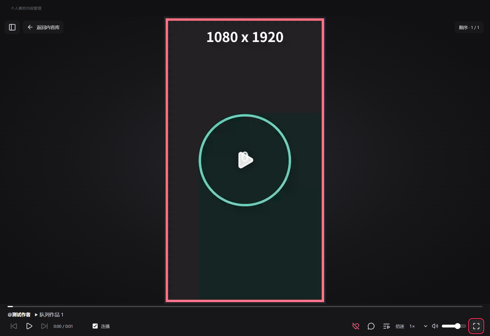

## 0.4.0 播放交互调整

关闭连播时循环当前视频；图集每张固定 3 秒，末张回到首张，音乐循环且换图不重建音轨。开启连播时末张等待音乐结束后进入下一作品；手动翻图停在当前张并暂停自动切作品，可通过“恢复轮播”继续。倍速调节视频与音乐，不改变图片停留时间。

作者、发布日期和两行省略文案浮在画面底部，长文案可展开滚动并收起；收起重置文案滚动位置，滚动文案不触发切作品。翻图按钮分置画面左右。底栏移除点赞任务入口，倍速使用纵向菜单，支持键盘选择、Esc 和点击外部关闭。进度条平时为细淡线，悬停或键盘操作时加粗并显示带光圈的圆点，拖动不改变布局高度。

队列展开状态由播放器外层保留，按钮、队列跳转、滚轮或自然连播切作品后保持打开，用户手动关闭。新增三项桌面测试覆盖上述行为；图集手动停留检查超过图片和音乐的结束时间，菜单补验最小窗口、展开左栏及 150% 缩放。

51 项单元测试、完整 29 项 Windows 生产包测试、类型与格式检查通过；免安装 EXE 自解压、启动、退出和重启，以及 EXE / ZIP 完整性检查通过。EXE 为 101,781,003 字节，ZIP 为 157,216,715 字节；本机该组 5 万条查询首次约 201ms、p95 116ms。测试使用独立临时账号与受控媒体，没有访问真实账号或发出真实写请求。

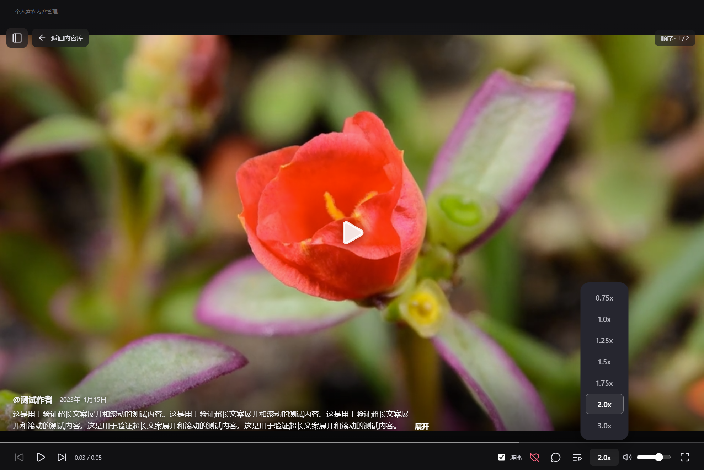

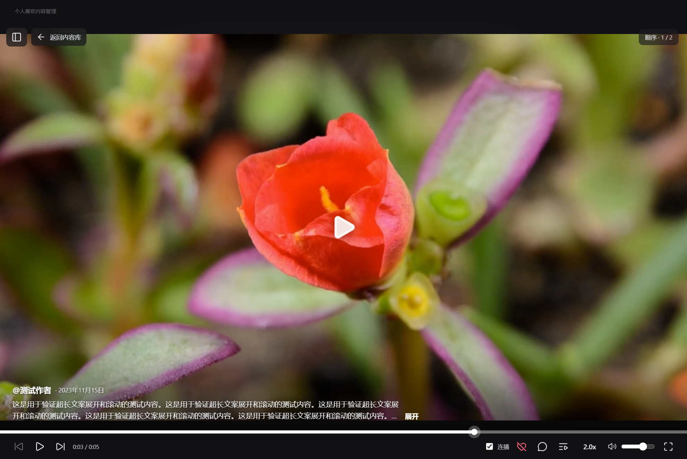

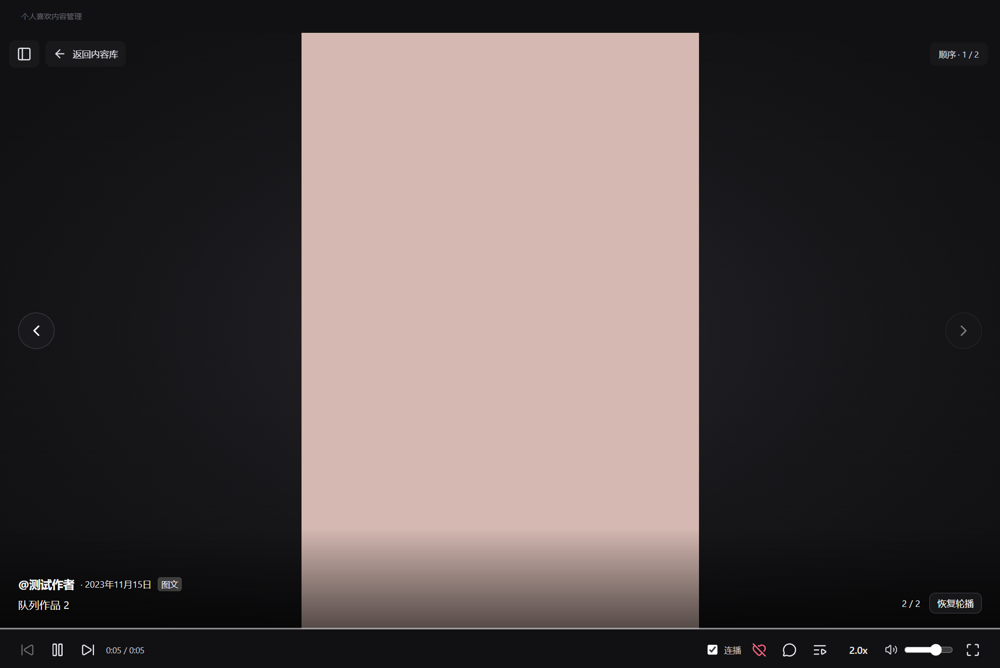

## 0.4.1 窄栏与实况末帧停留

播放时移除独占 43px 的窗口拖动栏，将拖动区域并入 30px 的浮动顶栏，窗口按钮同步缩小；常规宽度底栏由 52px 缩至 38px，给媒体多留出 57px 高度。保留等比完整显示，窄窗口或页面放大时控件仍可换行。

静态图仍每张 3 秒；实况先播完片段，再停在末帧 2 秒，随后翻图或重播。停留按实际时间计时，倍速不缩短它；暂停冻结倒计时，恢复后继续，手动翻图取消旧片段的停留与重播。图集音乐在停留期间继续播放，整体暂停时一起暂停。

8 项开发构建相关桌面检查、51 项单元测试、16 项相关 Windows 生产包回归通过；类型、格式、单 EXE 启动重启和 EXE / ZIP 完整性检查通过。新增实际解码的双倍速实况检查，覆盖自动翻图前的末帧停留、同图重播、暂停超过 2 秒再继续，以及手动换图后的旧回调隔离。默认与最小窗口的媒体区占播放器高度超过 93%，浮动顶栏不占布局高度，底栏不超过 38px；补查竖视频、竖图与实况的缩放、侧栏展开和全屏边界，以及续播、原页、后台取消点赞时播放和离开时取消取链。本轮按播放相关改动验证，未重复运行无关的数据管理流程。

免安装 EXE 为 101,780,310 字节，ZIP 为 157,217,025 字节。全部检查使用独立临时目录、受控账号和可解码素材，没有访问真实账号或发出真实写请求。

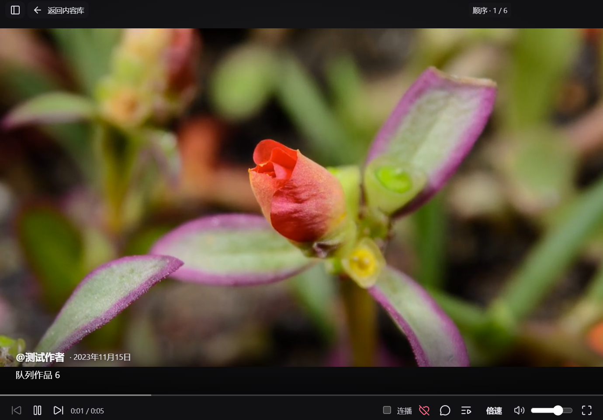

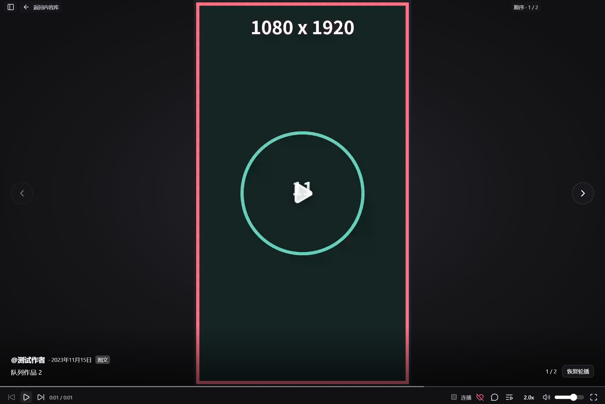

## 0.5.0 全屏与界面整理

全屏从随队列版本重建的播放器移到稳定外层，切作品仍释放旧媒体；按钮、队列跳转、滚轮、自然连播和重播共用同一全屏节点。返回先暂停，播放器淡出、内容库淡入；侧栏只做透明度与位移过渡，不逐帧挤压播放器宽度。内容库保留有界 DOM、搜索、筛选和滚动，尊重系统减少动画设置。

实况停顿改回显示该张静态照片 2 秒，动态就绪后再显示视频；静态资源失败时用首帧兜底，音乐和暂停规则保留。旧版 [player.html](../../src/DouyinShuffle.Win/WebUi/player.html) 已将静态图与动态层分开，本轮恢复此行为；公开参考未完成同类实况的可复验观察。本机浏览器对照因自动审批无法可靠确认当前网址而终止，不把旧代码注释当作官方实测。

主界面去掉标语、重复计数、排序下拉和闲置状态说明；搜索放在顶部，顺序 / 洗牌播放移到原搜索框所在的筛选栏。普通提示改为短暂浮层，错误仍明确保留。播放顶栏保留返回与侧栏开关，队列位置移入底栏。

开发构建相关检查、51 项单元测试、类型与格式检查通过。33 项 Windows 生产包回归分批通过：首次整组 30 项通过，另 3 项竖屏测试因仍测量已隐藏且带过渡位移的内容库而失败；改为检查实际播放器外框后，视频、静态图与实况的窗口 / 侧栏 / 缩放 / 全屏检查全部通过。返回动画用可见窗口采样，确认中间透明度、宽度稳定、同一内容库 DOM、筛选与滚动恢复；实况测试检查对应照片、2 秒停留、暂停、手动换图与图片失效兜底。

生产包 5 万条查询首次约 228ms、p95 132ms。免安装 EXE 自解压、启动、退出和重启，以及 EXE / ZIP 完整性检查通过；EXE 为 101,780,527 字节，ZIP 为 157,217,167 字节。本轮功能检查使用独立临时目录与受控素材，没有发出真实取消点赞请求。

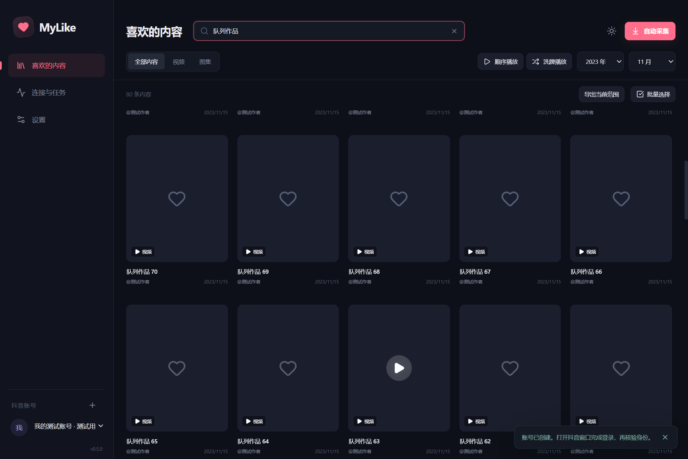

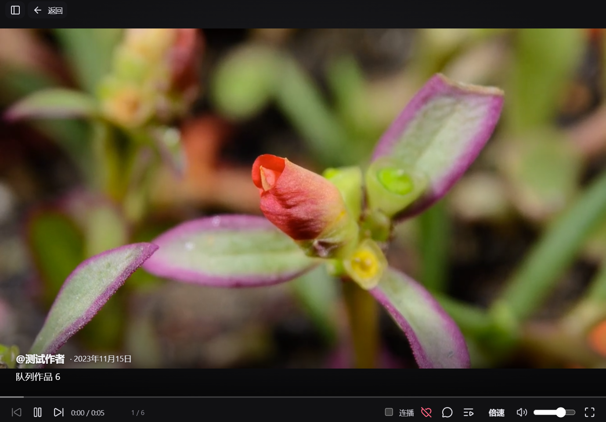

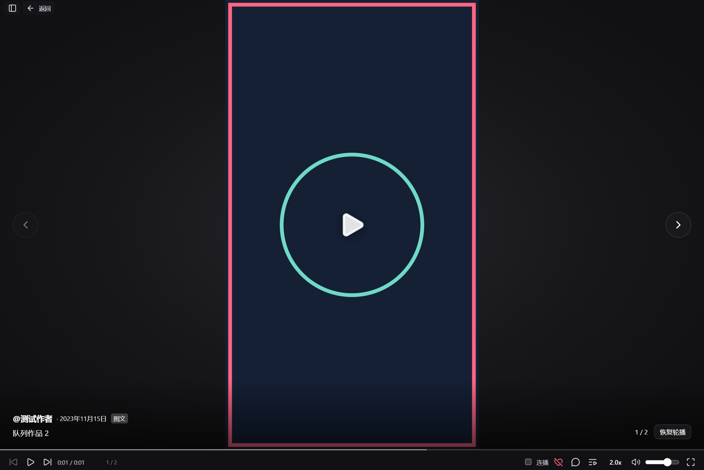

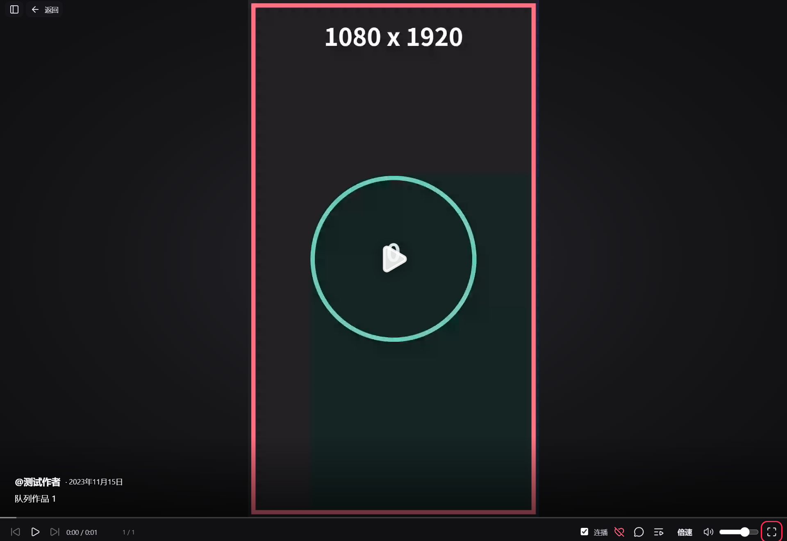

## 0.6.0 播放控件与列表避让

保留浮动顶栏和默认 38px 底栏，突出播放键、整理控件间距与选中状态，不减少媒体区域。播放列表改为紧凑标题、数量、类型与当前播放标记，跨作品保持展开。

列表顶部按系统标题栏区域留出间隔，全屏时使用 12px 边距。新增桌面检查覆盖最小窗口、100% / 125% / 150% 缩放、最大化、全屏切作品和手动收起；同时检查列表与关闭按钮的实际边界。Windows 在 HTML 全屏下可能保留旧的标题栏几何报告，验证按实际全屏状态判断。生产回归结果见 [M4](M4.md)。

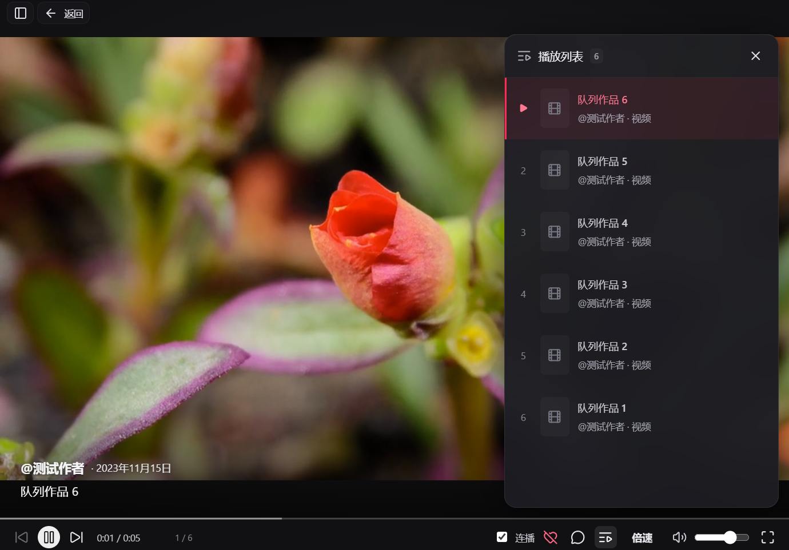

## 0.6.1 外部原页与透明播放键

播放 / 暂停键改为与前后切换一致的透明底。原页入口先暂停并保存当前位置，再由主进程调用 [Electron shell.openExternal](https://www.electronjs.org/docs/latest/api/shell#shellopenexternalurl-options) 打开系统默认浏览器；不再创建内置评论窗口或监听其关闭。浏览器登录态独立，回到应用后手动继续，打开失败保留暂停并显示原因。

桌面测试在实际生产主进程拦截系统打开调用，验证固定 HTTPS 作品地址、没有内置原页窗口、暂停保存与手动继续、旧队列及非法 ID 拒绝、默认处理程序失败反馈，以及切歌后不被旧动作恢复。没有启动用户浏览器或使用真实账号，因此不将其记为 Edge / Chrome 的人工登录验收。完整回归见 [M4](M4.md)。

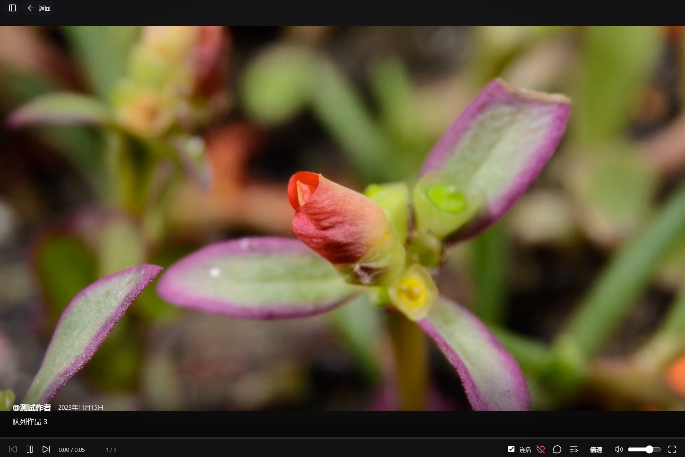
